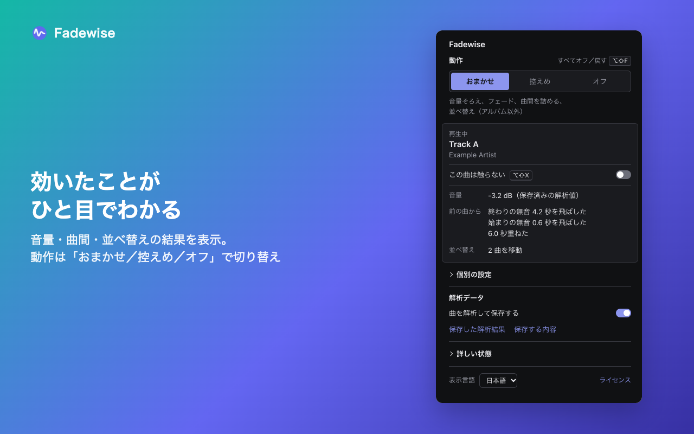
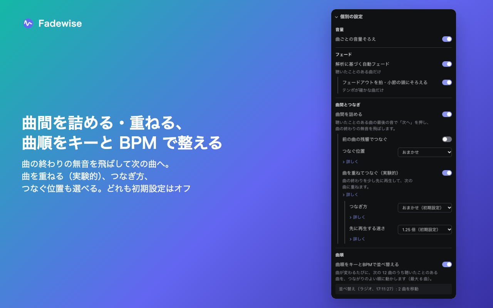
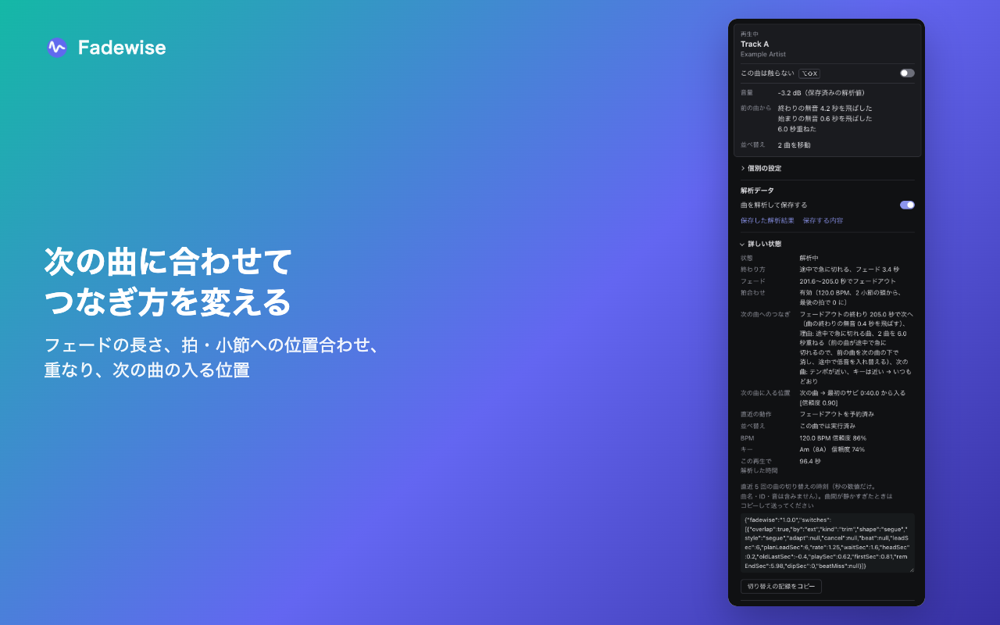
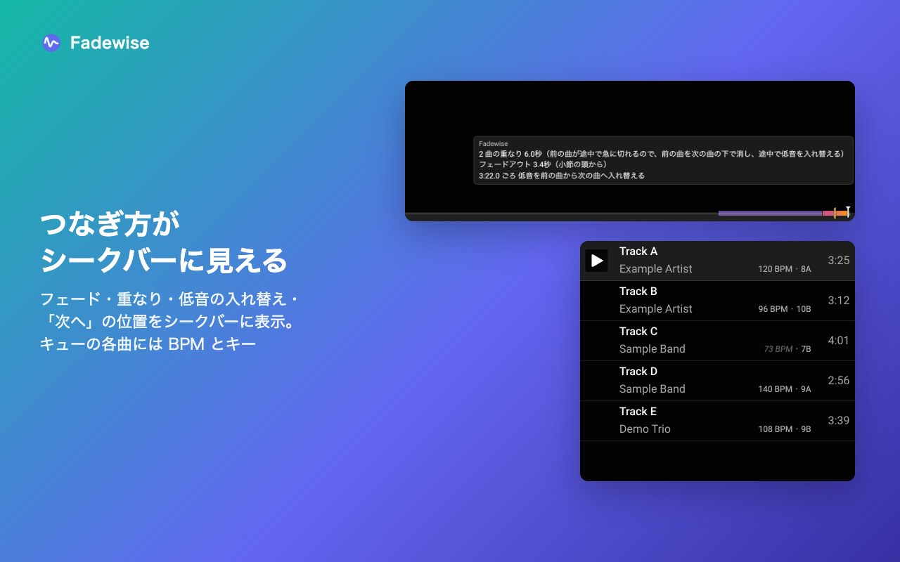
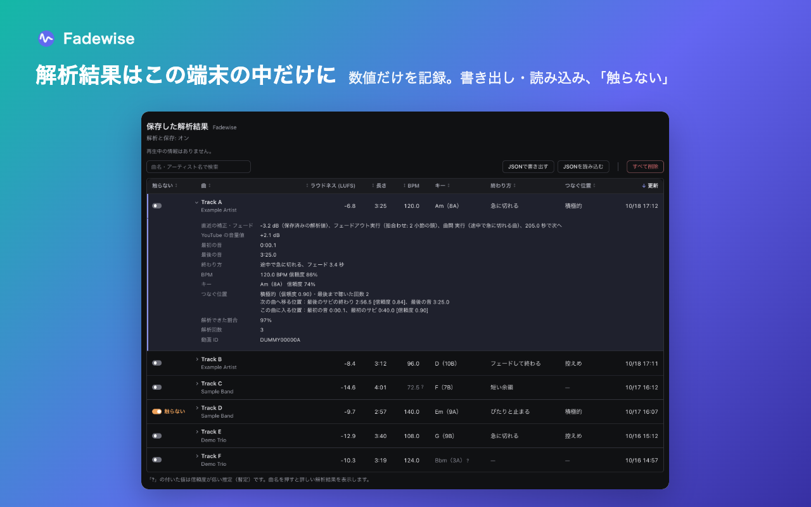

<div align="center">
  <a href="https://github.com/HoshimuraYuto/fadewise">
    
  </a>
  <h1>Fadewise</h1>
</div>

<p align="center" style="display: flex; justify-content: center; gap: 20px;">
  <a href="https://ko-fi.com/hoshimurayuto">
    
  </a>
</p>

[English](./README.md) | [日本語](./README.ja.md)

## Fadewise とは

Fadewise は YouTube Music™ 向けの Chrome 拡張機能です。聴いた曲を端末の中で解析し、次にその曲を再生するときに使います。曲ごとの音量をそろえ、ブツッと切れる終わり方の曲だけをフェードします。オンにすると、曲間を詰め、曲を重ね、キューの曲順をキーと BPM で並べ替えます。

再生は YouTube Music のプレーヤーのままです。2 つ目のプレーヤーを開いたり、曲をダウンロードしたり、音声を保存したりはしません。



### 主な機能

| 機能                                               | 初期設定 | すること                                                                                                                                                                                                                                                                                                                                                                                                                                                                                                                                                                                                                                                               |
| -------------------------------------------------- | -------- | ---------------------------------------------------------------------------------------------------------------------------------------------------------------------------------------------------------------------------------------------------------------------------------------------------------------------------------------------------------------------------------------------------------------------------------------------------------------------------------------------------------------------------------------------------------------------------------------------------------------------------------------------------------------------- |
| 曲ごとの音量そろえ                                 | オン     | 曲ごとの大きさを共通の目標に近づけます。まだ解析していない曲は YouTube が示す音量値を使います。                                                                                                                                                                                                                                                                                                                                                                                                                                                                                                                                                                        |
| 解析に基づく自動フェード                           | オン     | 音が鳴ったまま終わる曲にだけ、2〜4 秒のフェードアウトをかけます。テンポが確かな曲では拍・小節の頭にそろえます。                                                                                                                                                                                                                                                                                                                                                                                                                                                                                                                                                        |
| 曲間を詰める                                       | オフ     | 曲の最後の音のところでプレーヤーの「次へ」を押し、曲の終わりの無音を飛ばします。次の曲の頭の無音も、解析で無音と分かっている範囲（最大 6 秒）を飛ばします。2 曲のテンポとキーの関係に合わせてフェードを変えます。音がつながっているアルバムの曲はそのままにします。前の曲の残響でつなぐこともできます。                                                                                                                                                                                                                                                                                                                                                                |
| 曲を重ねてつなぐ（実験的）                         | オフ     | 「曲間を詰める」と一緒に使います。聴いたことのある曲の終わりで再生速度を一時的に上げ、先に再生した最大 10 秒の音をメモリにため、次の曲の頭に重ねて流します。重ねる長さは、前の曲の終わり方・次の曲の始まり方・キーとテンポの相性から曲の組ごとに決めます。つなぎ方は、**おまかせ**（初期設定）が曲の組ごとに重ね方を選び（テンポが離れている組は前の曲の余韻やフェードに重ね、テンポが近い組は 2 曲とも大きいまま重ねて次の曲を高い音から開く。どちらも途中で低音を前の曲から次の曲へ入れ替える。テンポが近く拍が安定した組では、次の曲の入りを少しずらして拍をそろえる）、**シンプル**は音量だけを入れ替えます。先に再生する速さは 1.25 倍（初期設定）か 1.5 倍です。 |
| つなぐ位置                                         | 控えめ   | 曲間を詰めるときに使います。**控えめ**は静かなイントロを飛ばし、静かなアウトロを切ります。**積極的**（実験的）は次の曲を最初のサビから始め、前の曲を最後のサビの終わりで切ります。**おまかせ**は「積極的」の位置のうち確かなものだけを使います。                                                                                                                                                                                                                                                                                                                                                                                                                       |
| 曲順をキーと BPM で並べ替える                      | オフ     | 曲が変わるたびに、次の 12 曲のうち解析済みの曲を、キーとテンポのつながりがよい順に動かします（最大 6 曲）。アルバムは「アルバムも並べ替える」をオンにしたときだけ。手で動かした曲はそのままにします。                                                                                                                                                                                                                                                                                                                                                                                                                                                                  |
| シークバーにフェードとつなぎのタイミングを表示する | オン     | フェードの始まり、「次へ」を押す位置、重なりと低音を入れ替える位置、曲に入る位置・曲を切る位置をシークバーに表示します。                                                                                                                                                                                                                                                                                                                                                                                                                                                                                                                                               |
| キューの各曲に BPM とキーを表示する                | オン     | キューの解析済みの曲に BPM とキーを表示します。                                                                                                                                                                                                                                                                                                                                                                                                                                                                                                                                                                                                                        |
| 「視聴を続けますか？」に自動で応答                 | オフ     | 確認に自動で応答し、再生を続けます。                                                                                                                                                                                                                                                                                                                                                                                                                                                                                                                                                                                                                                   |

表示は日本語と英語です。

## インストール

Chrome ウェブストアで公開するまでは、リリースから入れます。

1. [リリースページ](https://github.com/HoshimuraYuto/fadewise/releases)から `fadewise-<バージョン>-chrome.zip` をダウンロードする
2. 展開する
3. `chrome://extensions` を開き、「デベロッパー モード」をオンにする
4. 「パッケージ化されていない拡張機能を読み込む」で、展開したフォルダー（`manifest.json` があるフォルダー）を選ぶ

Chrome 116 以降が必要です。

初めて入れると、保存する内容を示すページが開きます。「同意して解析を始める」を押した後にだけ解析結果を保存します。同意しない場合は、YouTube の音量値による音量そろえだけが動きます。

## 使い方

YouTube Music（`music.youtube.com`）で曲を再生し、ツールバーの Fadewise のアイコンを押してポップアップを開きます。

### ポップアップ

- 一番上：再生中の曲と、その曲にしたこと（音量、前の曲からのつなぎ、直前の並べ替え）。
- **動作**：聴くための機能をまとめて切り替えます。
  - **おまかせ**：音量そろえ・フェード・曲間を詰める・並べ替え（アルバムと残響は除く）。
  - **控えめ**：音量そろえとフェードだけ。曲順と曲間はそのままです。初期設定はこれです。
  - **オフ**：何もしません。解析と保存は「曲を解析して保存する」に従います。
- **曲を解析して保存する**：オフにすると新しい解析結果を保存しません。保存済みの値は使い続けます。
- **個別の設定**：上の表の各機能。どれかを変えると、動作は「個別に設定中」になります。「曲を重ねてつなぐ」「つなぎ方」「先に再生する速さ」「つなぐ位置」は動作の切り替えでは変わりません。
- **詳しい状態**：再生中の曲の状態。終わり方、予定のフェード、拍合わせ、次の曲への曲間とその理由（重ねるなら重ね方）、次の曲に入る位置、BPM とキー。下の「切り替えの記録をコピー」で、直近 5 回の曲の切り替えの時刻（秒の数値だけ。曲名・ID・音は含まない）をコピーできます。曲間が静かすぎたときの報告に使えます。この記録はブラウザーを閉じると消え、保存も送信もしません。





### この曲は触らない

再生中の曲の下の「この曲は触らない」をオンにすると、その曲には音量・フェード・曲間・並べ替えのどれもしません。解析は続けるので、戻したときにすぐ使えます。同じ切り替えが「保存した解析結果」画面の一番左の列にもあります。

### キーボードショートカット

Chrome にフォーカスがあるときに使えます。`chrome://extensions/shortcuts` で変えられます。

| キー                                         | 動作                                                   |
| -------------------------------------------- | ------------------------------------------------------ |
| <kbd>Alt</kbd>+<kbd>Shift</kbd>+<kbd>F</kbd> | すべてオフ／オフにする前の設定に戻す（初回はおまかせ） |
| <kbd>Alt</kbd>+<kbd>Shift</kbd>+<kbd>X</kbd> | 再生中の曲を触らない／戻す                             |

### シークバーとキュー

フェードや曲間のつなぎを予定している曲では、シークバーに印が出ます。バーにマウスを乗せると、それぞれの印の説明が出ます（フェードアウト、「次へ」を押す位置、飛ばした無音、重なりと重ね方、低音を入れ替える位置〔黄色の線〕、入る位置・切る位置とそれを選んだ理由）。取り消された印も薄く残ります。

「キューの各曲に BPM とキーを表示する」がオンなら、キューの解析済みの曲に `120 BPM・8A` のように出ます（キーはキャメロット表記）。薄い斜体は信頼度の低い推定です。



### 保存した解析結果

ポップアップの「保存した解析結果」で、解析した曲の表が開きます。ラウドネス、最初と最後の音、終わり方、BPM、キー、つなぐ位置、直近の再生でかけた補正、解析回数などです。曲名・アーティスト名で検索でき、列ごとに並べ替えられます。並べ替えの履歴、「JSONで書き出す」「JSONを読み込む」「すべて削除」もこの画面にあります。



## 聴くほど効く

- **その曲を初めて聴くとき**：音量は YouTube の音量値でそろえます。「曲間を詰める」がオンなら、曲の終わりの無音を再生中に見つけて飛ばします（フェードはしません）。
- **2 回目から**：保存した解析を使います。測ったラウドネスでの音量そろえ、必要な曲だけのフェード、拍に合わせたフェード、終わり方に合わせたつなぎ、キーと BPM での並べ替え、控えめのつなぐ位置。
- **「積極的」のつなぐ位置**は、その曲を最初から最後まで通して聴くと使えます。まだのときは「保存した解析結果」の「つなぐ位置」の列で分かります。

## プライバシー

- 保存するのは、音から計算した数値と、曲の ID・曲名・アーティスト名です。保存先はこの端末のブラウザーの中です。音声は保存しません。
- 外部には何も送信しません。広告・アクセス解析・アカウントはありません。
- 権限は `storage` だけで、動くのは `music.youtube.com` だけです。
- 「保存した解析結果」の「すべて削除」か、アンインストールで消えます。

詳しくは[プライバシーポリシー](https://hoshimurayuto.github.io/fadewise/privacy/)を見てください。

## うまく動かないとき

- **拡張機能を入れた・更新した・読み込み直した後は、YouTube Music のタブを再読み込みしてください。** Chrome は開いているタブに新しい版を入れず、古い版はそのタブで止まります。
- **初めて聴く曲では、フェード・曲間のつなぎ・並べ替えが動きません。** 保存した解析が必要です。最初のページで同意したか（ポップアップの「保存する内容」）、「曲を解析して保存する」がオンかを確かめてください。
- **ポップアップの「詳しい状態」を見てください。** 状態（広告中、ミュート中、一時停止中など）と、フェードやつなぎを予定していない理由が出ます。
- 広告の再生中は解析も補正もしません。ミュート中は解析しません。
- 拍合わせは、BPM が 60〜200 で、信頼度が 50% 以上のときだけです。
- 並べ替えは、ページを操作している間は待ちます。曲の残りが 20 秒未満のときや、曲間のつなぎが近いときは、その曲では行いません。次の 12 曲に BPM とキーが確かな曲が 2 曲以上必要です。アカウントの自動生成ミックスは並べ替えません。理由はポップアップと並べ替えの履歴に出ます。
- 重ねるために先に再生している間は、シークバーと時間の表示が、聞こえている位置より最大 10 秒先を示します。

## 開発者向け

### 必要なもの

- Node.js 22.18 以降
- pnpm
- Chrome 116 以降

### ビルド

```sh
pnpm install
pnpm test         # 単体テスト
pnpm build        # 本番ビルド（app/.output/chrome-mv3/）
pnpm zip          # 本番ビルドの zip（app/.output/）
pnpm build:verify # 診断用のフックを入れたビルド（app/.output/chrome-mv3-verify/。配布しない）
```

試すときは、`app/.output/chrome-mv3/` を「パッケージ化されていない拡張機能を読み込む」で読み込みます。

## ライセンス

[GPL-3.0-or-later](./LICENSE)。サードパーティのコードと参考文献は [THIRD_PARTY_NOTICES.md](./app/public/THIRD_PARTY_NOTICES.md) にあります。

YouTube および YouTube Music は Google LLC の商標です。Fadewise は Google LLC および YouTube が作成・承認したものではなく、両者と関係はありません。
