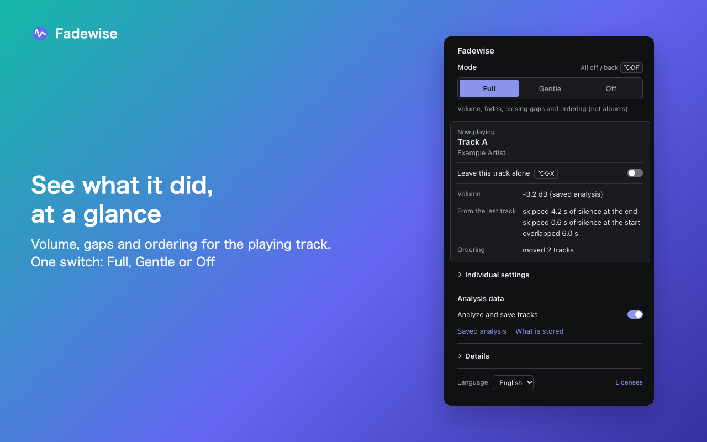
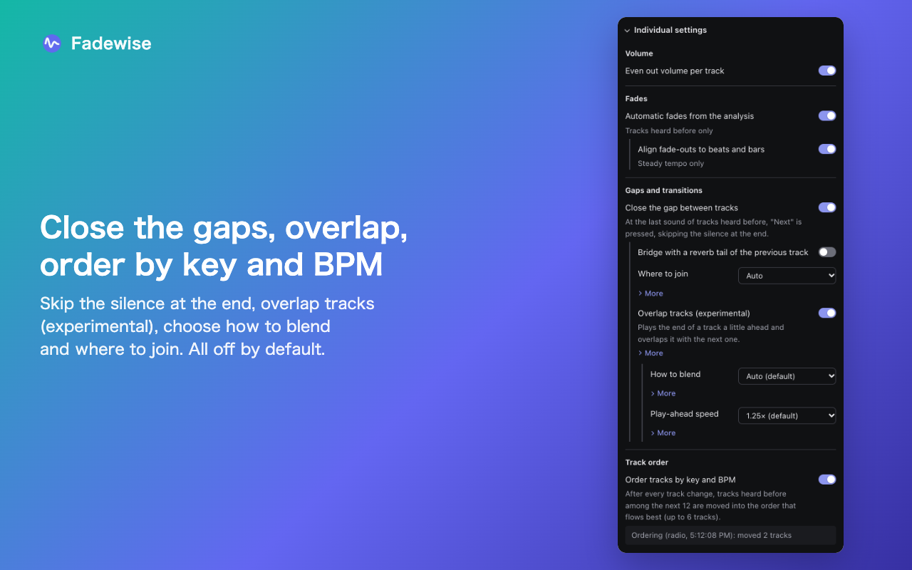
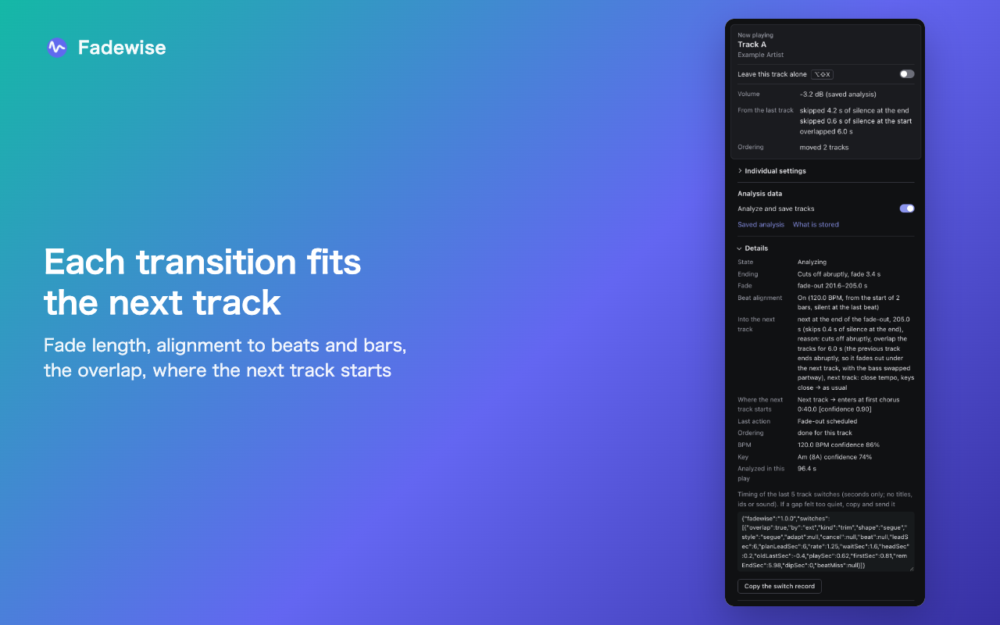
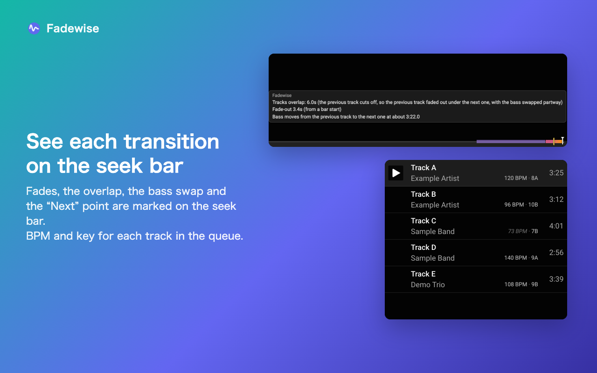
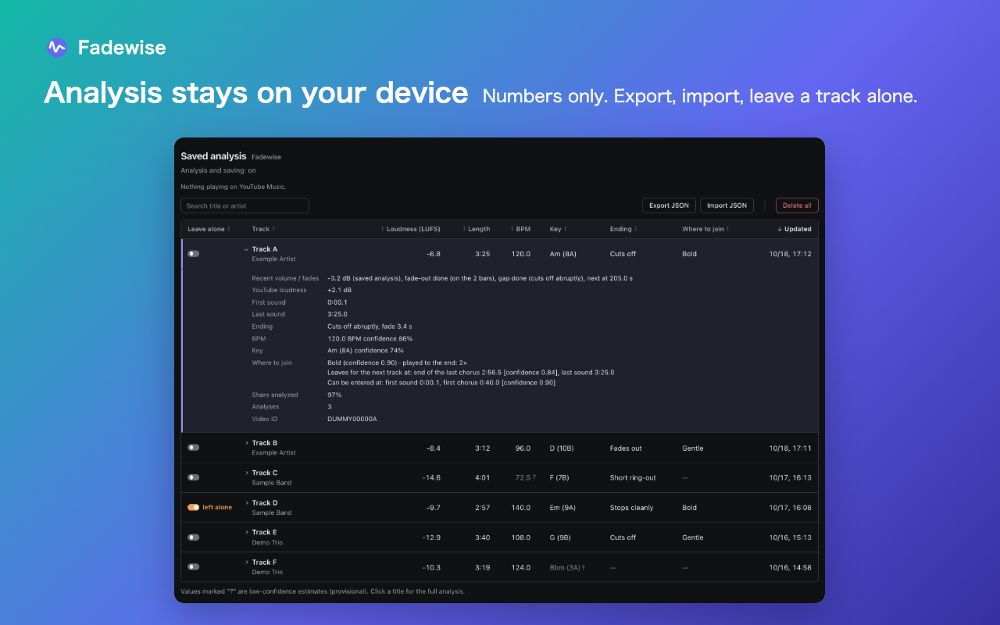

<div align="center">
  <a href="https://github.com/HoshimuraYuto/fadewise">
    
  </a>
  <h1>Fadewise</h1>
</div>

<p align="center" style="display: flex; justify-content: center; gap: 20px;">
  <a href="https://ko-fi.com/hoshimurayuto">
    
  </a>
</p>

[English](./README.md) | [日本語](./README.ja.md)

## What is Fadewise?

Fadewise is a Chrome extension for YouTube Music™. It learns each track while you listen, on your device, and uses what it learned the next time the track plays: it evens out the volume, fades only the endings that cut off abruptly and, if you turn these on, closes the gaps between tracks, overlaps them, and orders the queue by key and BPM.

Playback stays in the YouTube Music player. Fadewise does not open a second player, download tracks or save audio.



### Key Features

| Feature                                         | Default | What it does                                                                                                                                                                                                                                                                                                                                                                                                                                                                                                                                                                                                                                                                                                                                                                                                                                                                                           |
| ----------------------------------------------- | ------- | ------------------------------------------------------------------------------------------------------------------------------------------------------------------------------------------------------------------------------------------------------------------------------------------------------------------------------------------------------------------------------------------------------------------------------------------------------------------------------------------------------------------------------------------------------------------------------------------------------------------------------------------------------------------------------------------------------------------------------------------------------------------------------------------------------------------------------------------------------------------------------------------------------ |
| Even out volume per track                       | On      | Brings each track towards a common loudness. Tracks not analyzed yet use YouTube's own loudness value.                                                                                                                                                                                                                                                                                                                                                                                                                                                                                                                                                                                                                                                                                                                                                                                                 |
| Automatic fades from the analysis               | On      | A 2–4 s fade-out, only for tracks that stop while still loud. When the tempo is steady, the fade lines up with beats and bars.                                                                                                                                                                                                                                                                                                                                                                                                                                                                                                                                                                                                                                                                                                                                                                         |
| Close the gap between tracks                    | Off     | Presses the player's **Next** at the last sound of a track, skipping the silence at its end. Silence at the start of the next track is skipped too, as far as the analysis shows it is silent (up to 6 s). The fade adapts to how the tempo and key of the two tracks relate. Album tracks that run into each other are left alone. Optionally bridges the gap with a reverb tail.                                                                                                                                                                                                                                                                                                                                                                                                                                                                                                                     |
| Overlap tracks (experimental)                   | Off     | Works with Close the gap between tracks. Near the end of a track heard before, the playback speed is raised for a moment, up to 10 seconds played ahead are held in memory, and they play over the start of the next track. How long the tracks overlap is chosen for each pair (how the previous track ends, how the next one starts, how well keys and tempos match). How to blend: **Auto** (default) picks a blend for each pair (tracks with tempos far apart overlap over the fade or ring-out of the previous track; tracks with close tempos overlap with both at full volume, the next one opening from its high end; the bass moves from one track to the other partway through; for pairs with close tempos and a steady beat, the next track comes in slightly shifted so the beats line up), **Simple** changes only the volume. The speed for playing ahead is 1.25× by default or 1.5×. |
| Where to join                                   | Gentle  | Used when closing the gaps. **Gentle** skips a quiet intro and cuts a quiet outro. **Bold** (experimental) starts the next track at its first chorus and leaves the previous one at the end of its last chorus. **Auto** uses the Bold points only where they are confident.                                                                                                                                                                                                                                                                                                                                                                                                                                                                                                                                                                                                                           |
| Order tracks by key and BPM                     | Off     | After every track change, moves the analyzed tracks among the next 12 into the order whose keys and tempos follow each other best (up to 6 tracks). Albums only if you tick **Albums too**. Tracks you moved yourself stay where you put them.                                                                                                                                                                                                                                                                                                                                                                                                                                                                                                                                                                                                                                                         |
| Show fade and transition timing on the seek bar | On      | Shows on the seek bar where a fade starts, where **Next** will be pressed, the overlap and where the bass swaps, and where a track is entered and left.                                                                                                                                                                                                                                                                                                                                                                                                                                                                                                                                                                                                                                                                                                                                                |
| Show BPM and key in the queue                   | On      | Shows each analyzed track's BPM and key in the queue.                                                                                                                                                                                                                                                                                                                                                                                                                                                                                                                                                                                                                                                                                                                                                                                                                                                  |
| Answer "Continue watching?" automatically       | Off     | Answers the prompt so playback continues.                                                                                                                                                                                                                                                                                                                                                                                                                                                                                                                                                                                                                                                                                                                                                                                                                                                              |

The UI is in English and Japanese.

## Installation

Until Fadewise is on the Chrome Web Store, install it from a release:

1. Download `fadewise-<version>-chrome.zip` from the [releases page](https://github.com/HoshimuraYuto/fadewise/releases).
2. Unzip it.
3. Open `chrome://extensions` and turn on **Developer mode**.
4. Choose **Load unpacked** and select the unzipped folder (the one that contains `manifest.json`).

Requires Chrome 116 or later.

On first install, a page opens that lists what will be stored. Analysis results are saved only after you press **Agree and start analyzing**. Without agreeing, only volume leveling by YouTube's loudness value works.

## Basic Usage

Open YouTube Music (`music.youtube.com`) and play. Click the Fadewise icon in the toolbar to open the popup.

### The popup

- At the top: the playing track and what was done for it — the volume change, how it followed the last track, and the last reordering.
- **Mode**: one switch for the listening features.
  - **Full**: volume, fades, closing the gaps and ordering (not albums, no reverb).
  - **Gentle**: volume and fades only. Track order and gaps stay as they are. This is the default.
  - **Off**: does nothing. Analyzing and saving still follow **Analyze and save tracks**.
- **Analyze and save tracks**: turn off to stop saving new results. Results already saved are still used.
- **Individual settings**: each feature in the table above. Changing one shows the mode as **Custom settings**. Overlap, How to blend, the speed for playing ahead and Where to join are not changed by the mode.
- **Details**: the state of the playing track — how it ends, the planned fade, beat alignment, the gap to the next track and why (and how the tracks are blended when they overlap), where the next track is entered, BPM and key. **Copy the switch record** below it copies the timing of the last 5 track switches (seconds only; no titles, IDs or sound), for reporting a gap that felt too quiet. This record is cleared when the browser closes and is never saved or sent.





### Leave this track alone

Tick **Leave this track alone** under the playing track to stop all volume changes, fades, gap handling and ordering for that track. It is still analyzed, so the numbers are there when you switch it back. The same switch is in the first column of the Saved analysis page.

### Keyboard shortcuts

They work while Chrome has focus. Change them at `chrome://extensions/shortcuts`.

| Keys                                         | Action                                                                    |
| -------------------------------------------- | ------------------------------------------------------------------------- |
| <kbd>Alt</kbd>+<kbd>Shift</kbd>+<kbd>F</kbd> | Turn everything off, or back to the settings before (Full the first time) |
| <kbd>Alt</kbd>+<kbd>Shift</kbd>+<kbd>X</kbd> | Leave the playing track alone, or not                                     |

### Seek bar and queue

While a planned fade or transition is coming, marks appear on the seek bar. Hover over the bar to read what each mark is: a fade-out, where **Next** is pressed, the skipped silence, the overlap and how the tracks are blended, where the bass swaps (a yellow line), and the entry and exit points with the reason they were chosen. A mark that was canceled stays, drawn faintly.

With **Show BPM and key in the queue**, each analyzed track in the queue shows something like `120 BPM · 8A` (the key in Camelot notation). A faint italic value is a low-confidence estimate.



### Saved analysis page

**Saved analysis** in the popup opens a table of every analyzed track: loudness, first and last sound, how it ends, BPM, key, where it can be joined, what was applied on recent plays, and how often it was analyzed. You can search by title or artist and sort by any column. The page also shows the ordering history and has **Export JSON**, **Import JSON** and **Delete all**.



## It works better the more you listen

- **First play of a track**: volume uses YouTube's loudness value. With Close the gap between tracks on, the silence at the end is detected as it plays and skipped, without a fade.
- **From the second play**: the saved analysis is used — volume from the measured loudness, fades only where needed, beat-aligned fades, transitions planned from how the track ends, ordering by key and BPM, and the Gentle join points.
- **Bold join points** need a play of the whole track from start to end. The Where to join column of the Saved analysis page tells you when a track still needs one.

## Privacy

- Only numbers computed from the audio are saved, together with the video ID, title and artist, in the browser on your device. Audio is never saved.
- Nothing is sent anywhere. There are no ads, analytics or accounts.
- The only permission is `storage`, and the extension runs only on `music.youtube.com`.
- **Delete all** on the Saved analysis page, or uninstalling, deletes the data.

Details: [Privacy Policy](https://hoshimurayuto.github.io/fadewise/privacy/)

## Troubleshooting

- **After installing, updating or reloading the extension, reload the YouTube Music tab.** Chrome does not add the new version to tabs that are already open, and the old one stops working in that tab.
- **Fades, gaps and ordering do nothing on a track you have not heard before.** They need a saved analysis. Check that you agreed on the first-run page (**What is stored** in the popup) and that **Analyze and save tracks** is on.
- **Look at Details in the popup.** It shows the state (for example ad, muted, paused) and the reason when no fade or transition is planned.
- Nothing is analyzed or adjusted while an ad plays, and nothing is analyzed while the player is muted.
- A fade is aligned to beats only when the BPM is between 60 and 200 and its confidence is at least 50%.
- Ordering waits while you use the page, and skips a track when less than 20 s of it is left or a transition is coming. It needs at least 2 tracks with a sure BPM and key among the next 12. Auto-generated mixes of your account are not reordered. The reason is shown in the popup and in the ordering history.
- While a track plays ahead to overlap, the seek bar and the time are up to 10 seconds ahead of what you hear.

## Developer Information

### Requirements

- Node.js 22.18 or later
- pnpm
- Chrome 116 or later

### Build

```sh
pnpm install
pnpm test         # unit tests
pnpm build        # production build in app/.output/chrome-mv3/
pnpm zip          # zip of the production build in app/.output/
pnpm build:verify # build with diagnostic hooks in app/.output/chrome-mv3-verify/ (do not distribute)
```

To try a build, load `app/.output/chrome-mv3/` with **Load unpacked**.

## License

[GPL-3.0-or-later](./LICENSE). Third-party code and references are listed in [THIRD_PARTY_NOTICES.md](./app/public/THIRD_PARTY_NOTICES.md).

YouTube and YouTube Music are trademarks of Google LLC. Fadewise is not made or endorsed by, or affiliated with, Google LLC or YouTube.
